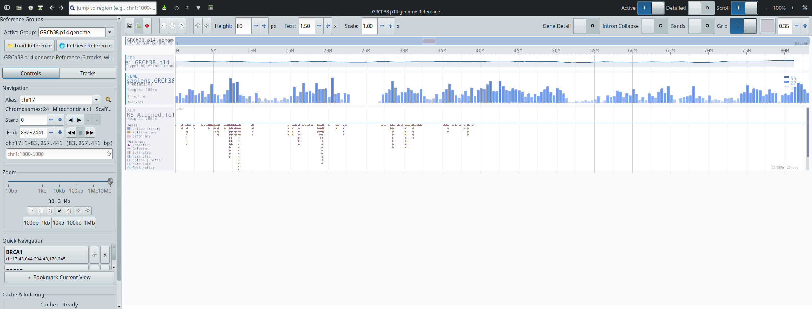
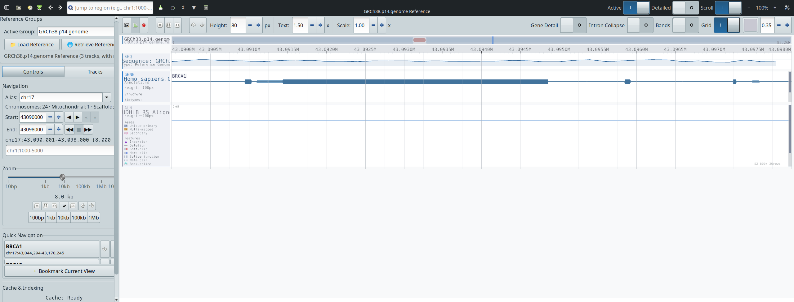
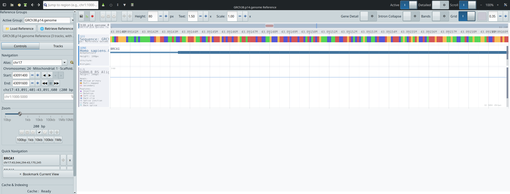
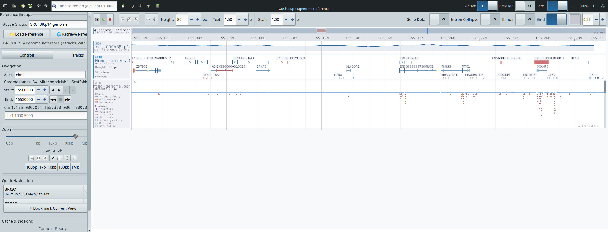
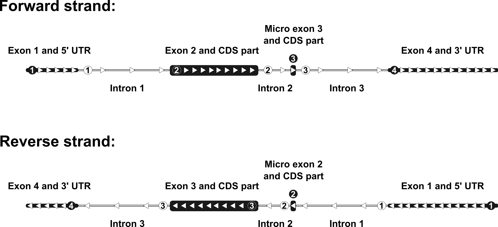

# VX: an AI-agent-controllable desktop genome and transcriptome browser with a programmable analysis framework

> **A fast, cross-platform, GPU-accelerated desktop genome and
> transcriptome browser, built from the ground up for *AI-agent
> driven* exploration of sequencing data.**
> Visualise FASTA / GTF / GFF / BAM / BED / BigBed / bedGraph /
> BigWig / VCF / BEDPE interaction tracks; run 59 built-in
> computational analyses against them; drive the whole thing from
> Claude, an LLM agent, or a plain `curl` command through an
> embedded HTTP API.

<p align="center">
  
</p>

<p align="center">
  <a href="https://github.com/Arnaroo/VX/releases"></a>
  <a href="LICENSE-binaries.txt"></a>
  <a href="mcp/LICENSE"></a>
  <a href="api/LICENSE"></a>
  
</p>

---

## What VX is for

VX is a **desktop genome browser** in the family of IGV, UCSC
Genome Browser, JBrowse, JBrowse 2, SeqMonk, Tablet, Pileup.js,
and Pretzel, built around a different set of needs. It targets
four audiences that the current generation of browsers serves
less well:

1. **Researchers** working with very large sequencing datasets
   (multi-GB BAM, BigWig, BEDPE contact lists, multi-sample VCF)
   on a laptop, who need a viewer that stays responsive while the
   reads of a region of a 23 GB BAM load in the background.
2. **Bioinformaticians and computational biologists** who want
   to *run* analyses against the data while looking at it. Run
   peak calling, differential expression, splice junctions,
   transcript quantification, base modification sites, poly(A)
   tail statistics, copy number, alignment QC, variant density,
   contact matrices and TAD boundaries, cross-track correlation,
   directly from the viewer, in the background, with file exports.
3. **AI / agentic-LLM users** who want a genome browser their
   agent can *see and control*: navigate the viewport, load
   files, capture tracks as images, run analyses and read their
   result files, edit an annotation, export regions, all through a
   structured tool catalogue.
4. **Educators and figure-makers** who want a reproducible,
   scriptable viewer that produces publication-grade output
   (PNG, JPEG, TIFF and SVG images, and MP4 / WebM / GIF
   recordings of the viewport through ffmpeg).

If you do **NGS, RNA-seq, ChIP-seq, ATAC-seq, Hi-C, long-read
sequencing, direct RNA sequencing, variant calling, comparative
genomics, transcript isoform analysis, ribosome profiling,
CLIP-seq, methylation sequencing, MeRIP-seq, or any other
sequencing-based assay** and you've ever wished your genome
browser was faster, smarter, or scriptable, VX is built for you.

---

## Why VX is different

| Capability | What it means in practice |
|---|---|
| **GPU-accelerated rendering** | OpenGL drawing with levels of detail that follow the zoom: a whole chromosome (10⁸ bp) as feature density, then gene outlines, exons and, at the bottom, single bases (10⁰ bp). |
| **Async, background-thread BAM loading** | BAM regions are read on a worker thread. The view keeps panning and zooming over the reads already held while the next window loads, and a load-status strip at the bottom of the viewport tells you *why* the alignments aren't there yet. |
| **80-tool MCP server + HTTP API** | Built-in HTTP server on `127.0.0.1:9876` (91 commands through `POST /command`, plus `GET` endpoints for the state and for captures), and an MCP server of 80 tools over it. Claude Code, Claude Desktop or any other MCP client (through the MCP server), a Python script or `curl` can navigate, load files, query genes, capture images, run analyses and read their result files, edit the reference and its annotation, manage bookmarks and sessions, and record video. |
| **59 built-in analyses** | Peak calling, RPKM/TPM/CPM quantification, differential expression, splice junctions, transcript quantification, gene body coverage, ORF prediction, CNV segmentation, contact matrices, modification sites, poly(A) tail statistics, modification co-occurrence, GC content, motif search, signal correlation, variant annotation, coding impact, Ts/Tv, MAPQ distribution, insert sizes, strand bias, TAD boundaries, profile plots, gap detection and more, all in a background thread with file output (BED, BED12, bedGraph, TSV, bedMethyl, BEDPE) and a manifest of each run (its inputs with their SHA-256, the parameters as applied). |
| **Reads in aggregate** | Beside an alignment track, a modification density track (base modifications from the MM and ML tags, per site, window or bin, with a binomial or Fisher's test and Benjamini-Hochberg q), a poly(A) tail track (Dorado's tail lengths) and, new in 0.11.0, a variant summary (the bases of every read against the reference, with a binomial test or Fisher's test against a control library). Each can be drawn as a strip of the alignment track or as a track of its own, and its rows exported as TSV (a modification density's also as bedMethyl). |
| **New views in 0.11.0** | Sashimi tracks (depth and splice junction arcs) and overlay tracks (several signals in one lane); the Matrix display of an interaction track (contacts binned and balanced as cooler balances them); the calls matrix (a row a read, a column a modified site); a circular view of a mitochondrion, plasmid or bacterial chromosome with read chords; a dot plot of a region against itself, another region or a transcript. |
| **Edit mode** | Add, move, resize, rename and delete genes, transcripts, exons and features, set strands and biotypes, insert, delete or replace bases, with undo and redo; every coordinate of the tracks held in memory moves with a base edit. Write the edited reference (FASTA and `.fai`), annotation (GTF or GFF3) and features (BED). |
| **Genomes and transcriptomes** | Each reference has a group of its own, with a reference mode (auto, genome or transcriptome) that the overview, the analyses and the modifications' names follow. Every quantitative track has one value axis (linear, log2, log10, square root or asinh; fitted or a range you set). The Known Features pane shows what public services (Ensembl, UniProt, STRING, IntAct, PDB, NCBI Gene) say about a gene, transcript or protein you choose. |
| **Built-in video / GIF recording** | Capture the OpenGL viewport to MP4 (H.264), WebM (VP9) or GIF through ffmpeg (installed separately). Two modes: timer-paced (constant fps) or render-paced (every frame). Quality and frame rate user-controlled. For figure animations, talks, supplementary movies. |
| **Subsampling + transparency** | Alignment tracks honour a configurable read cap (default 500 reads in view) and a `min_mapq` filter, set per track in the track panel or through the API. The reads held are a sample of the whole window, the same at every visit, and the coverage strip counts every read of the window, not only the sample. When a view is subsampled, a *badge* on the track says so (`kept/total`). Captures and the SVG export render the reads the view shows. |
| **Self-contained binaries** | No Python runtime, no Conda environment, no web stack. One download per platform (9.9 MB for Linux, 24.7 MB for macOS, 61.7 MB for Windows): the macOS and Windows packages carry GTK and the libraries it uses; on Linux VX uses the distribution's GTK 3, FreeType and OpenGL driver. Unpack, or drag to Applications, and run. |
| **Three platforms, pre-compiled** | Linux x86-64 and Windows x86-64 (one build each, for x86-64-v3 processors), macOS on Apple silicon (`VX.app` in a `.dmg`). Built with LDC, the LLVM-based D compiler, with the D runtime and Phobos linked in statically; full LTO on Linux and Windows. |
| **No account; usage statistics only if you opt in** | VX is a desktop application with no account and no cloud service. Anonymous usage statistics are opt-in and off by default: VX asks at the first start (and, after a *Not now*, once more ten launches later), shows the exact fields, and sends nothing unless you agree. Otherwise VX goes on the network only for these: a demo dataset you open (this repository's `demo-data-v1` release); a genome you retrieve (Retrieve Reference); UCSC's chromosome band table, when you load a reference read as a genome whose file or folder name names a known assembly (GRCh38, hg38, mm10 and others) and neither a `cytoBand.txt` beside it nor VX's cache holds the table (it is then kept in that cache); and a Known Features tab you open or refresh (the identifier you chose, and those the services' answers give, go to the services turned on in Settings; *Use the cache only* sends nothing). The HTTP API listens on `127.0.0.1` only and refuses requests from pages in a web browser. Your data stays on your machine. |

If you've used IGV and wished it were faster, or JBrowse and
wished it weren't a browser tab, or Pileup.js and wished it ran
big files, or any genome browser and wished an AI agent could
drive it, VX was written with those wishes in mind.

---

## Screenshots

<table>
<tr>
<td></td>
<td></td>
</tr>
<tr>
<td align="center"><em>Chromosome scale: the whole of chromosome 17 (83 Mb), its genes drawn as a density histogram, with the sequence and an alignment track.</em></td>
<td align="center"><em>Gene level: 126 kb around BRCA1, each gene with its exons and introns, coloured by biotype.</em></td>
</tr>
<tr>
<td></td>
<td></td>
</tr>
<tr>
<td align="center"><em>Exon level: 8 kb of BRCA1, the translated part of each exon (the translon) at full height, the UTRs thinner.</em></td>
<td align="center"><em>Base level: 200 bp, each base a coloured bar.</em></td>
</tr>
<tr>
<td></td>
<td></td>
</tr>
<tr>
<td align="center"><em>Several tracks together: sequence, genes and alignments over 300 kb of chromosome 1.</em></td>
<td align="center"><em>Anatomy of a gene track: exons, UTRs, the translated part, introns, strand arrows.</em></td>
</tr>
</table>

The screenshots were taken with VX 0.9.0; the window of 0.11.0
differs in details, and the views new in 0.11.0 are not shown.

---

## Quick install

### 1. Download the right binary for your platform

Visit the **[Releases page](https://github.com/Arnaroo/VX/releases)**
and grab one asset for your system:

| Platform | Asset | Size |
|---|---|---|
| **Linux x86-64** (an x86-64-v3 processor, with AVX2: Intel Haswell, AMD Excavator or later; glibc 2.34 or later) | `VX-0.11.0-linux-x86_64.tar.gz` | 9.9 MB |
| **macOS arm64** (Apple silicon, macOS 26 or later) | `VX-0.11.0-macos-arm64.dmg` | 24.7 MB |
| **Windows x86-64** (Windows 10 or 11; an x86-64-v3 processor) | `VX-0.11.0-windows-x86_64.zip` | 61.7 MB |

Each asset has a matching `.sha256` file beside it. Verify before
running:

```bash
sha256sum -c VX-0.11.0-linux-x86_64.tar.gz.sha256          # Linux
shasum -a 256 -c VX-0.11.0-macos-arm64.dmg.sha256          # macOS
certutil -hashfile VX-0.11.0-windows-x86_64.zip SHA256     # Windows: compare with the .sha256 file
```

### 2. Unpack / install

**Linux** relocatable tarball:
```bash
tar xzf VX-0.11.0-linux-x86_64.tar.gz
./VX-0.11.0-linux-x86_64/bin/vx
```
The tarball holds VX, the font it draws with (DejaVu Sans Mono,
with its licence) and its documents (`README-INSTALL.txt` says
what is where). VX uses the distribution's GTK 3, FreeType and
OpenGL driver (OpenGL 3.3 or later), which most desktops have;
otherwise:
- Debian, Ubuntu: `sudo apt install libgtk-3-0 libfreetype6 libgl1`
- Fedora: `sudo dnf install gtk3 freetype mesa-libGL`
- Arch: `sudo pacman -S gtk3 freetype2 libglvnd`

The binary needs glibc 2.34 or later (Ubuntu 22.04, Debian 12,
RHEL 9, Fedora 35 and later releases). fontconfig (the system's fonts),
libcurl (the demo datasets, Retrieve Reference, the chromosome band
tables, the Known Features pane and the opt-in usage statistics) and
ffmpeg (video recording) are used when present.

**macOS arm64** `.dmg`:
1. Open `VX-0.11.0-macos-arm64.dmg` and drag `VX.app` into the
   `Applications` folder.
2. First start: VX is signed ad hoc, not notarised, so macOS
   refuses it the first time. Click Done, open System Settings >
   Privacy & Security, click **Open Anyway** beside the line
   about VX and confirm. Later starts open at once.
3. Or, before the first start, from Terminal:
   `xattr -dr com.apple.quarantine /Applications/VX.app`

The disk image's `README.txt` says the same.

**Windows x86-64** relocatable ZIP:
1. Extract `VX-0.11.0-windows-x86_64.zip` anywhere.
2. Run `vx.exe` in the extracted `vx-windows` folder. Nothing is
   installed system-wide. `vx-console.exe` beside it is the same
   program for a terminal: the command line, `--headless` and
   `--analysis` (whose answer it prints).
3. Windows SmartScreen may warn at the first start (the program
   is not signed): choose *More info*, then *Run anyway*.

### 3. Verify it works

While VX runs it serves an HTTP API on `127.0.0.1:9876` (on by
default; Settings > MCP / API). From any shell:

```bash
curl -s http://127.0.0.1:9876/ping
# → {"status":"ok","app":"VX","api_version":2}
```

That's your installation test.

---

## Drive VX from Claude or any LLM (MCP)

VX comes with an open-source MCP server
([`mcp/vx_mcp_server.py`](mcp/vx_mcp_server.py), MIT) of 80
tools that exposes the viewer to AI agents that speak the
**Model Context Protocol**: Claude Code, Claude Desktop, and any
MCP-compatible client. Its capture tools return the image itself,
which a vision model sees.

```bash
# One-time setup
pip install -r mcp/requirements.txt      # fastmcp and httpx

# Then in your Claude Code config (or Claude Desktop config):
#   "vx": { "command": "python", "args": ["/path/to/vx_mcp_server.py"] }
```

See [`mcp/INSTALL.md`](mcp/INSTALL.md) for the full Claude
Desktop / Claude Code JSON snippets and
[`api/examples/claude_mcp_recipes.md`](api/examples/claude_mcp_recipes.md)
for seven worked agent recipes (BRCA1 figure, coverage walk, GC
analysis, subsampled-BAM inspection, bookmark tour, SVG export,
video recording).

---

## Drive VX from a script (HTTP API)

Every MCP tool calls VX's HTTP API, which any HTTP client can call
directly: 91 commands through `POST /command`, beside `GET /ping`,
`GET /state` and the capture endpoints. An error answer carries
an HTTP status (400, 403, 404, 405, 409, 501, 503, 504 or 500) and a
JSON body with `error` and `code`. Since 0.11.0 the API refuses a
request sent by a page in a web browser (403 `FORBIDDEN_ORIGIN`).
The schema is [`api/openapi.yaml`](api/openapi.yaml) (OpenAPI 3.1).
Three runnable examples:

- **bash + curl:** [`api/examples/curl_navigate.sh`](api/examples/curl_navigate.sh)
- **Python (stdlib only):** [`api/examples/python_client.py`](api/examples/python_client.py)
- **Claude agent recipes:** [`api/examples/claude_mcp_recipes.md`](api/examples/claude_mcp_recipes.md)

```bash
# Navigate to BRCA1
curl -X POST -H 'Content-Type: application/json' \
     -d '{"command":"navigate","params":{"chromosome":"17","start":43044295,"end":43125483}}' \
     http://127.0.0.1:9876/command

# Screenshot the viewport at 2x scale
curl -s 'http://127.0.0.1:9876/screenshot/viewport?scale=2.0' \
     -o brca1.png

# Run a peak-calling analysis on the visible region
curl -X POST -H 'Content-Type: application/json' \
     -d '{"command":"run_analysis","params":{"type":"SimplePeakCalling","tracks":["ChIP_signal"]}}' \
     http://127.0.0.1:9876/command
```

---

## What you get out of the box

### Built-in computational analyses (59, each in a background thread)

The names are the API's. The window shows each in words
("GC Content"); four go by other names there, given in brackets.

**Signal & quantification:** `SignalDifference`, `SignalRatio`,
`ZScoreNormalization`, `FeatureCounts`, `RPKM`, `TPM`, `CPM`,
`PerExonCoverage`, `BinStatistics`, `RegionDifferential`

**RNA-seq:** `DifferentialExpression`,
`SpliceJunctions`, `TranscriptQuantification`, `GeneBodyCoverage`

**Peak calling & enrichment:** `SimplePeakCalling`,
`EnrichmentOverInput`, `FeatureProminence`, `CoverageAnomalies`,
`VariantDensityHotspots`, `GapDetection`, `CnvSegmentation`

**Sequence:** `GCContent`, `CpGDensity`, `MotifSearch`,
`RepeatDensity`, `NucleotideFrequency`, `OrfPrediction`

**Intervals:** `IntervalIntersection`, `IntervalSubtraction`,
`IntervalUnion`, `ClosestFeature`

**Variants:** `VariantAnnotation`, `TsTvRatio`, `VariantDensity`,
`AlleleFrequencySpectrum`, `VariantIntersection`, `CodingImpact`

**Alignment QC:** `MappingQualityDistribution`,
`InsertSizeDistribution`, `StrandBias`, `DuplicateRate`,
`SoftClipFrequency`, `ChimericReadDensity`, `ReadLengthDistribution`,
`PerBaseMismatchRate` (Edit Rate), `MismatchRate`

**Modifications and poly(A):** `ModificationSites`,
`PolyAStatistics`, `ModificationCoOccurrence`

**Hi-C / interaction:** `ContactFrequencyVsDistance`,
`InteractionEnrichment` (Interactions at Features),
`InteractionEnrichmentOverExpected` (Interaction Enrichment),
`TADBoundaryDetection`, `ContactMatrix`

**Cross-track:** `SignalCorrelation`, `SignalAtFeatures`,
`HeatmapMatrix`, `ProfilePlotData`

**Export:** `TrackExport` (Export Track Data)

New in 0.11.0: `DifferentialExpression`, `SpliceJunctions`,
`TranscriptQuantification`, `GeneBodyCoverage`, `OrfPrediction`,
`CnvSegmentation`, `ContactMatrix`, `ModificationSites`,
`PolyAStatistics` and `ModificationCoOccurrence`.

Each analysis writes its result to a configurable results
directory: a BED, bedGraph or TSV file, and for some analyses also
a BED12 (ORF Prediction), bedMethyl (Modification Sites) or BEDPE
(Modification Co-occurrence) file (Export Track Data writes a
variant track as VCF), with a manifest beside it
(`<result>.manifest.json`: the VX version, each input file with
its size and, up to a size set in Settings, its SHA-256, the
parameters as applied, the region), and can add the result as a
new track, right below its input track. The 49 analyses of 0.10.0
are checked from outside by a validation package (MIT): Python
reference implementations of the 49 analyses, fixtures with
expected outputs, and a runner that drives a VX binary through its
HTTP API and compares every file it writes. The ten analyses
added in 0.11.0 were tested on real data.

### File formats supported

**Sequence:** FASTA (`.fa`, `.fasta`, `.fna`, `.fas`), plain or gzip.
**Annotation:** GTF, GFF, GFF3, plain or gzip.
**Alignments:** BAM, with its `.bai` index beside it; SAM, read as
a coverage track.
**Signal:** BigWig, bedGraph, Wiggle.
**Intervals:** BED (BED3, BED6, BED12), BigBed.
**Variants:** VCF, plain, gzip or BGZF.
**Interaction:** BEDPE (paired contacts, such as Hi-C loops).
**Transcript integrity:** INDEGRA's process table (`{sample}_process.txt`).
**Sessions:** `.vxs`.

BED, bedGraph and Wiggle files may also be gzip-compressed. A
`.cool`, `.mcool` or `.hic` file is refused with the reason: write
its contacts as BEDPE (`cooler dump --join`). See
[`docs/FILE_FORMATS.md`](docs/FILE_FORMATS.md) for the full
matrix.

### Export formats

**Static:** PNG, JPEG and TIFF (the viewport at a chosen scale;
through the API also the whole window and a single track as
PNG), SVG (the viewport, as editable vector graphics), the circular
view and the dot plot (SVG or PNG), the view's sequence (FASTA) or
genes and features (GFF), a track's data (VCF, bedGraph or TSV), an
aggregate track's rows (TSV or bedMethyl), analysis results (BED,
BED12, bedGraph, TSV, bedMethyl, BEDPE, with their manifests), the
Edit mode's reference (FASTA and `.fai`), annotation (GTF or GFF3
with its gene index) and features (BED), a Known Features tab
(Markdown or JSON), session save / restore (`.vxs`).
**Animated:** MP4 (H.264), WebM (VP9), GIF direct viewport
capture via ffmpeg pipe.

---

## Known limitations in v0.11.0

These are documented up front so you can decide whether v0.11.0
fits your workflow.

- **Signing.** The macOS bundle is signed ad hoc only (no
  Developer ID, no notarisation): macOS refuses its first start
  until you allow it in System Settings > Privacy & Security
  (*Open Anyway*). The Windows program is not signed, so
  SmartScreen may warn at its first start.
- **No Windows installer.** Windows is distributed as a ZIP that
  runs from any folder; there is no `.exe` or `.msi` installer in
  v0.11.0.
- **First-region BAM fetch** on a cold, very large BAM (about
  20 GB and more) can take about 2 minutes the first time you
  navigate into a chromosome. The load-status strip shows that
  the fetch is running; later regions are fast.
- **No web/cloud version.** VX is a desktop application. If you
  need an embeddable browser-tab viewer, JBrowse 2 may suit you
  better.

See [`docs/TROUBLESHOOTING.md`](docs/TROUBLESHOOTING.md) for
runtime troubleshooting.

---

## Repository layout

This repository is the **public-facing distribution tree** for
VX. The D source code that produces the binaries is held in a
separate private development tree under a proprietary licence
(see *Source code* below).

| Folder | Contents | Licence |
|---|---|---|
| [`mcp/`](mcp/) | Open-source Python MCP server for Claude / agents | **MIT** |
| [`api/`](api/) | OpenAPI 3.1 HTTP API spec + curl/Python/Claude examples | **MIT** |
| [`docs/`](docs/) | User guide, file-format guide, keyboard shortcuts, troubleshooting, build provenance, screenshots | **CC-BY-NC-ND-4.0** |
| [`binaries/`](binaries/) | Release-asset notes + SHA-256 verification recipes | **CC-BY-NC-ND-4.0** |
| [`third_party/`](third_party/) | The one change VX's build makes to GtkD, published as GtkD's licence asks | **LGPL-3.0-or-later** (the change) |
| Pre-compiled binaries | Attached to each tagged release under [**Releases**](https://github.com/Arnaroo/VX/releases) | **CC-BY-NC-ND-4.0** |

The per-folder licence matrix is reflected by `LICENSE-binaries.txt`,
`LICENSE-docs.txt`, `mcp/LICENSE` and `api/LICENSE`;
[`third_party/GTKD.md`](third_party/GTKD.md) states its own.

---

## Source code

The VX D source code is **proprietary and confidential** and is
held under a separate licence by Biocodecs Group / Arnaroo
Ribologicals. It is not distributed via this repository.

The pre-compiled binaries are licensed under
**CC-BY-NC-ND-4.0** (non-commercial, no-derivatives, with
attribution). For commercial licensing, OEM integration,
white-label deployment, or source-code access:
[contact@biocodecs.org](mailto:contact@biocodecs.org).

VX is based in part on works of the GtkD project (http://gtkd.org).
The libraries the macOS and Windows packages carry (GTK 3 and the
libraries it uses; on Windows also libcurl with OpenSSL) keep
their own licences: each package's `THIRD_PARTY_LICENSES.txt`
names every library it holds, with its version, licence and
source, followed by the licence texts. On Linux these libraries
come from the distribution. Every package holds the font VX draws
with, DejaVu Sans Mono, with its licence. The one change VX's
build makes to GtkD is published in
[`third_party/GTKD.md`](third_party/GTKD.md).

The **MCP server** ([`mcp/`](mcp/)) and the **HTTP API
specification** ([`api/`](api/)) ARE open source under MIT and
can be reused freely.

---

## Citing

If you use VX in research, please cite the accompanying
manuscript and the Zenodo DOI of the specific release you used.

**Cite the project (all versions, always resolves to the latest release):**

> Shirokikh, N. E., & Cleynen, A. *VX: an AI-agent-controllable desktop genome and transcriptome browser with a programmable analysis framework.* _Zenodo_ https://doi.org/10.5281/zenodo.20234450

**Cite bioRxiv preprint:**

>  *VX: an AI-enabled desktop genome viewer and transcriptome browser with a programmable analysis framework* Nikolay E Shirokikh, Alice Cleynen _bioRxiv_ 2026.05.17.725790; doi: https://doi.org/10.64898/2026.05.17.725790 

**Cite a specific release (v0.9.0.1, snapshot of the v0.9.0 "Aardvark" public pre-release):**

> Shirokikh, N. E., & Cleynen, A. (2026). *Arnaroo/VX: VX 0.9.0.1, archival re-publish.* Zenodo. https://doi.org/10.5281/zenodo.20234451

BibTeX:

```bibtex
@software{vx_genome_viewer,
  author       = {Shirokikh, Nikolay E. and Cleynen, Alice},
  title        = {{VX: an AI-agent-controllable desktop genome
                   and transcriptome browser with a programmable
                   analysis framework}},
  year         = {2026},
  publisher    = {Zenodo},
  doi          = {10.5281/zenodo.20234450},
  url          = {https://doi.org/10.5281/zenodo.20234450}
}
```

Once the accompanying manuscript is published, this block will
gain an additional reference to the journal article; the Zenodo
DOIs above will continue to resolve to the archived software
snapshots.

---

## Build provenance

For full transparency on how each release binary was produced, including
compiler version, flags, LTO settings, bundled libraries,
signing flow, recommended downstream verification, see
[`docs/BUILD_PROVENANCE.md`](docs/BUILD_PROVENANCE.md).

---

## Keywords

genome browser · transcriptome browser · sequence viewer ·
read alignment viewer · NGS · next-generation sequencing ·
RNA-seq · ChIP-seq · ATAC-seq · CLIP-seq · Hi-C · long-read
sequencing · Nanopore · direct RNA · PacBio · Illumina · variant viewer ·
VCF viewer · BAM viewer · GTF viewer · GFF viewer · FASTA
viewer · BigWig · BigBed · BedGraph · OpenGL · GPU-accelerated
visualisation · GTK3 · D language · LDC · cross-platform
bioinformatics · interactive genome visualisation · genome
visualization · transcriptome visualization · MCP · Model
Context Protocol · Claude · Anthropic · AI agent ·
LLM-driven analysis · agentic bioinformatics · HTTP API ·
peak calling · GC content · CpG density · motif search ·
Ts/Tv · variant density · alignment QC · MAPQ · insert size ·
strand bias · soft clip · TAD boundary · contact-vs-distance ·
contact matrix · heatmap · profile plot · signal correlation ·
feature counts · RPKM · TPM · CPM · differential expression ·
splice junctions · Sashimi plot · transcript quantification ·
gene body coverage · ORF prediction · copy number · CNV ·
base modifications · m6A · 5mC · modkit · bedMethyl · poly(A) tail ·
coverage anomaly · gene structure · exon · intron · UTR · CDS ·
isoform · transcript · circular genome view · dot plot ·
annotation editing · subsampling · async loading · video recording ·
screenshot · screencast · SVG export · reproducible figures ·
publication-grade · desktop bioinformatics · IGV alternative ·
JBrowse alternative · Tablet alternative · SeqMonk alternative ·
Pileup.js alternative.

